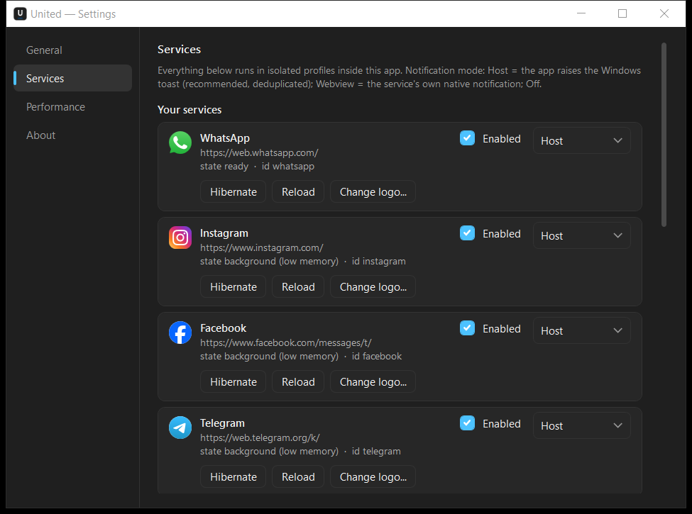
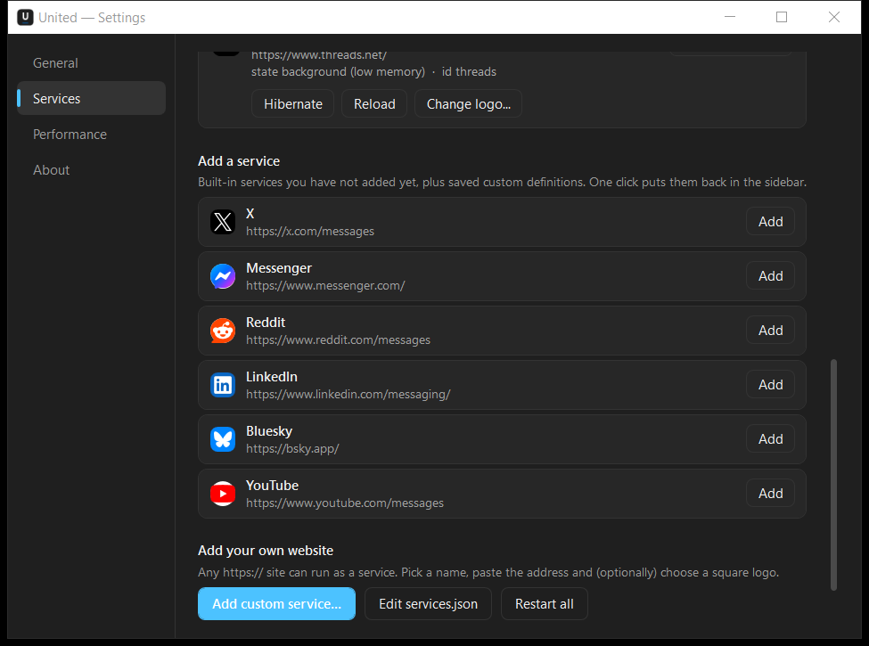
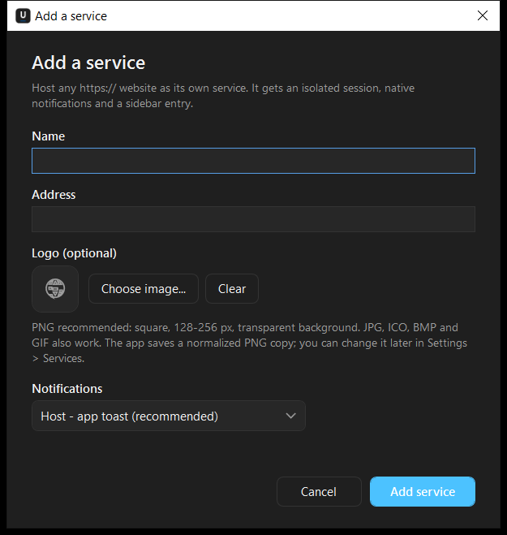
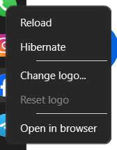

# Tutorial Lengkap United Messenger

**Versi 0.2.0** · diperbarui 22 Oktober 2026 · Windows 10 2004+ / Windows 11 (x64)

Tutorial ini menjelaskan cara memakai United dari nol: login, menambah layanan, mengganti logo, mengatur notifikasi, menghemat RAM, sampai troubleshooting. Semua label UI ditulis apa adanya (UI aplikasi berbahasa Inggris) dengan penjelasan dalam bahasa Indonesia.



## Daftar isi

1. [Apa itu United?](#1-apa-itu-united)
2. [Persyaratan & menjalankan](#2-persyaratan--menjalankan)
3. [Login ke layanan](#3-login-ke-layanan)
4. [Mengenal antarmuka](#4-mengenal-antarmuka)
5. [Menambah layanan bawaan/opsional](#5-menambah-layanan-bawaanopsional)
6. [Menambah layanan kustom lewat dialog](#6-menambah-layanan-kustom-lewat-dialog)
7. [Mengelola layanan (enable, remove, restart)](#7-mengelola-layanan-enable-remove-restart)
8. [Menambah layanan lewat services.json](#8-menambah-layanan-lewat-servicesjson)
9. [Mengganti logo layanan](#9-mengganti-logo-layanan)
10. [Notifikasi](#10-notifikasi)
11. [Memori, hibernasi, dan performa](#11-memori-hibernasi-dan-performa)
12. [Tema, startup, tray, dan shortcut](#12-tema-startup-tray-dan-shortcut)
13. [Data, backup, reset, uninstall](#13-data-backup-reset-uninstall)
14. [Troubleshooting](#14-troubleshooting)
15. [Build, test, publish (developer)](#15-build-test-publish-developer)
16. [Status verifikasi & batasan](#16-status-verifikasi--batasan)
17. [Lisensi & kredit](#17-lisensi--kredit)

---

## 1. Apa itu United?

United adalah **shell desktop** yang menjalankan situs resmi banyak layanan pesan di satu jendela Windows. Setiap layanan punya profil browser terisolasi (cookie/login sendiri), notifikasi Windows asli, dan entri sidebar.

Yang **bukan** United:

- Bukan klien API tidak resmi, bukan bot, bukan alat otomasi.
- Bukan aplikasi cloud; tidak ada server United yang menyimpan pesan Anda.
- Bukan pengganti akun Anda; Anda tetap login di situs resmi masing-masing.

Karena itu, semua perilaku (fitur, batas jumlah pesan, pemanggilan, verifikasi) tetap mengikuti situs aslinya.

---

## 2. Persyaratan & menjalankan

### 2.1 Prasyarat

| Kebutuhan | Detail |
|---|---|
| Windows | 10 build 19041 (2004) atau lebih baru, atau Windows 11, **64-bit** |
| .NET | .NET **10 Desktop Runtime** (build framework-dependent) |
| WebView2 | Microsoft Edge WebView2 Runtime (biasanya sudah ada karena Edge) |
| Akun | Akun Anda sendiri di tiap layanan |

Jika .NET belum ada, aplikasi akan menampilkan dialog runtime yang mengarah ke halaman unduhan Microsoft. WebView2 dapat diunduh dari situs Microsoft (Evergreen Runtime).

### 2.2 Menjalankan

**Dari folder portable:**

```
build\United-portable-win-x64\United.exe
```

**Dari source (development):**

```powershell
$env:Path = "$env:LOCALAPPDATA\Microsoft\dotnet;$env:Path"
dotnet build src\United.slnx
src\United.App\bin\Debug\net10.0-windows10.0.19041.0\United.exe
```

Saat pertama dijalankan, United:

- membuat shortcut Start Menu **United Messenger** (dibutuhkan agar toast Windows punya identitas/AUMID),
- mendaftarkan protokol `united://` per user (untuk klik toast),
- membuat folder data `%LOCALAPPDATA%\United`,
- menampilkan 6 layanan bawaan: WhatsApp, Instagram, Facebook, Telegram, Discord, Threads.

Tidak perlu hak administrator. Semua registrasi bersifat per-user.

> **Penting:** tombol **X** menyembunyikan aplikasi ke tray (default), bukan keluar. Notifikasi tetap hidup. Untuk keluar sepenuhnya: klik ikon tray → **Quit**, atau matikan **Close button hides to tray** di Settings.

### 2.3 Menutup, minimize, keluar

| Aksi | Hasil |
|---|---|
| Tombol **X** (close-to-tray aktif) | Jendela disembunyikan; aplikasi & notifikasi tetap berjalan |
| Tombol **—** (minimize) | Jendela diminimize ke taskbar |
| **Ctrl+M** | Minimize jendela |
| Tray → **Quit** | Keluar total; sesi & pengaturan disimpan |
| Tray → **Hibernate all services** | Semua WebView dihentikan sementara (RAM turun) |

---

## 3. Login ke layanan

Klik ikon layanan di sidebar, lalu login seperti biasa. Setiap layanan memakai profil WebView2 terpisah, jadi akun WhatsApp dan Facebook tidak saling bercampur cookie.

| Layanan | URL awal | Cara login | Status uji |
|---|---|---|---|
| WhatsApp | `web.whatsapp.com` | Pindai QR dari WhatsApp di ponsel | Login akun nyata + notifikasi live terverifikasi (21 Okt 2026) |
| Facebook | `facebook.com/messages/t/` | Email/telepon + password | Akun nyata; inbox + observer DOM diuji |
| Instagram | `instagram.com` | Login Instagram (popup Facebook diizinkan in-app) | Akun nyata; inbox + observer DOM diuji |
| Telegram | `web.telegram.org/k/` | QR atau nomor telepon | Akun nyata; observer + notifikasi live diuji |
| Discord | `discord.com/app` | Email + password, mungkin captcha | Akun nyata; observer + klik inbox diuji |
| Threads | `threads.com` | Login lewat Instagram | Akun nyata; observer + badge judul diuji |
| X, Messenger, Reddit, LinkedIn, Bluesky, YouTube | lihat Settings → Services | Login situs masing-masing | Belum diuji dengan akun |

Catatan:

- **Satu profil per layanan.** Untuk memakai dua akun WhatsApp, tambahkan layanan kustom kedua dengan URL WhatsApp yang sama; ia akan mendapat profil baru (cookie terpisah), lalu login akun kedua di sana. Cara ini tidak diuji dengan akun nyata.
- **Login popup** ke domain yang masih satu lingkup (mis. Facebook saat login Instagram) terbuka di jendela popup kecil yang berbagi sesi layanan. Tautan ke domain lain dibuka di browser default agar tab messenger tidak dibajak.
- **Sesi tersimpan** di `WebData`. Jangan hapus folder itu kecuali ingin logout semua layanan.
- Jika situs meminta verifikasi (captcha/2FA), selesaikan langsung di halaman yang tampil. United tidak memblokir verifikasi.
- Halaman Facebook `messages/t/` akan mengarah ke login bila belum masuk; setelah login, Facebook biasanya membuka kotak pesan secara otomatis. (Perilaku setelah login belum diverifikasi di mesin ini.)

---

## 4. Mengenal antarmuka

### 4.1 Sidebar

- Tombol **All messages** di atas daftar layanan (atau `Ctrl+0`) membuka inbox terpadu: daftar aktivitas/notifikasi terbaru dari semua layanan di kiri, webview layanan asli di kanan.
- Klik satu baris → percakapan terbuka di webview layanan itu dan fokus pindah ke editor chat, sehingga bisa langsung membalas. Daftar chat layanan tidak ikut tampil (tidak dobel), dan sidebar kontak layanan disembunyikan selama percakapan terbuka.
- Inbox hanya berbasis aktivitas/notifikasi yang tercapture — bukan salinan riwayat chat. Layanan yang di-hibernate tidak menghasilkan aktivitas baru.
- Baris diurutkan berdasarkan **waktu pesan masuk**. Notifikasi WhatsApp memakai timestamp UTC dari WebView2 yang dinormalkan ke waktu lokal, jadi pesan baru langsung naik ke atas.
- Ikon layanan tersusun vertikal; ikon aktif punya indikator di kiri.
- **Klik** = pindah layanan. Halaman yang tidak aktif tetap hidup (kecuali di-hibernate) sehingga notifikasi tetap masuk.
- **Klik kanan** = menu: Reload, Hibernate/Resume, Change logo..., Reset logo, Open in browser.
- **Tooltip** menampilkan nama layanan dan status.
- Urutan mengikuti `enabledServices` di `settings.json`; untuk mengubah urutan, edit file saat aplikasi tertutup lalu jalankan lagi.

### 4.2 Title bar & gear

- Judul: `United · <Nama Layanan>`.
- Tombol jendela: minimize, maximize, close.
- **Gear** di kiri bawah membuka **Settings**.

### 4.3 Settings

| Halaman | Isi |
|---|---|
| **General** | Tema (system/light/dark), launch at sign-in, start minimized, close-to-tray, tray badge, suara notifikasi, test notification, auto low-memory |
| **Services** | Daftar layanan aktif (logo, URL, status, id, Enabled, mode notifikasi), aksi per layanan, daftar layanan yang bisa ditambahkan, Add custom service, Edit services.json, Restart all |
| **Performance** | RAM host, RAM WebView2 tree, CPU, PID browser bersama, status tiap layanan |
| **About** | Versi dan path data (settings, WebData, services.json, icons, logs) |

### 4.4 Shortcut keyboard

| Shortcut | Fungsi |
|---|---|
| `Ctrl+0` | Buka **All messages** (inbox terpadu) |
| `Ctrl+1` … `Ctrl+9` | Aktifkan layanan ke-1 … ke-9 di sidebar |
| `Ctrl+,` | Buka Settings |
| `Ctrl+H` | Hibernate / resume layanan aktif |
| `Ctrl+M` | Minimize jendela |

Shortcut bekerja saat fokus berada di jendela United (bukan di dalam halaman web yang sedang menangkap tombol, mis. editor chat).

### 4.5 Tray

- Klik kiri / klik dua kali ikon tray = buka jendela.
- Menu: **Open United**, **Settings…**, **Hibernate all services**, **Quit**.
- Badge merah di ikon tray = total unread dari judul halaman (jika pola terdeteksi).

---

## 5. Menambah layanan bawaan/opsional

Layanan yang belum aktif muncul di **Settings → Services → Add a service**.

1. Buka **Settings** → **Services**.
2. Scroll ke bagian **Add a service**.
3. Klik **Add** pada salah satu: **X**, **Messenger**, **Reddit**, **LinkedIn**, **Bluesky**, **YouTube**.
4. Layanan langsung ditambahkan ke akhir sidebar dan dibuka.
5. Login seperti biasa.



Catatan:

- Layanan bawaan tidak bisa dihapus permanen, hanya **dinonaktifkan** (uncheck **Enabled**). Setelah dinonaktifkan, ia kembali muncul di daftar **Add a service**.
- Facebook sudah aktif secara default. Pengguna lama mendapatkannya otomatis lewat migrasi `settingsVersion` (sekali saja).
- “Add” tidak meminta konfirmasi; perubahan langsung disimpan ke `settings.json`.

---

## 6. Menambah layanan kustom lewat dialog

Cocok untuk situs yang tidak ada di daftar, mis. Slack, Mattermost, forum internal, atau web chat perusahaan.

### 6.1 Langkah

1. **Settings → Services → Add custom service...**
2. Isi:

   | Field | Keterangan |
   |---|---|
   | **Name** | Nama tampilan di sidebar (min. 2 karakter), mis. `Work Chat` |
   | **Address** | URL lengkap, mis. `https://chat.example.com/messages`. Jika skema tidak ditulis, `https://` ditambahkan otomatis |
   | **Logo (optional)** | **Choose image...** → PNG/JPG/ICO/BMP/GIF; pratinjau muncul. **Clear** untuk menghapus pilihan |
   | **Notifications** | **Host - app toast (recommended)**, **Webview - the site's own notification**, atau **Off** |

3. Klik **Add service**.



### 6.2 Yang terjadi setelah Add

- Id dibuat otomatis dari nama (slug), mis. `Work Chat` → `work-chat`; jika bentrok → `work-chat-2`.
- Definisi disimpan ke `%LOCALAPPDATA%\United\services.json`.
- Logo (jika dipilih) dinormalisasi ke PNG maksimal 256 px di `icons\<id>.png`.
- Layanan ditambahkan ke `enabledServices`, muncul di sidebar, dan langsung dibuka dengan profil baru.
- Halaman memakai mode notifikasi yang dipilih.
- Pola judul default `^\((?<count>\d+)\)` → badge angka jika judul halaman diawali `(3)`, dst.

### 6.3 Perilaku navigasi

- **Domain yang sama** (dan varian `www.`) tetap di dalam aplikasi.
- **Domain lain** (link keluar, iklan, dokumentasi) dibuka di browser default.
- **Popup login** ke domain lain akan dibuka di browser default — artinya login tidak selesai di aplikasi. Solusinya: tambahkan domain login ke `authPopupHosts` di `services.json` (lihat [bagian 8](#8-menambah-layanan-lewat-servicesjson)), lalu restart.
- Contoh kasus umum: layanan yang login lewat Google (`accounts.google.com`).

### 6.4 Tips memilih URL

- Gunakan URL **kotak masuk/langsung ke chat**, bukan landing page marketing.
- Untuk Slack: `https://app.slack.com/client`.
- Untuk Mattermost: `https://<server>/<team>/channels/<channel>`.
- Untuk forum: URL pesan langsung/notifikasi.
- Jika situs membutuhkan subdomain lain untuk berpindah halaman, tambahkan ke `originHosts` lewat JSON.

---

## 7. Mengelola layanan (enable, remove, restart)

### 7.1 Enabled / disabled

- Setiap baris di **Your services** punya checkbox **Enabled**.
- Uncheck = layanan ditutup dan dihapus dari sidebar, tetapi **definisinya tetap ada** (built-in atau custom). Ia pindah ke daftar **Add a service**.
- Check/Add kembali = dibuat ulang dengan profil yang sama (sesi login tetap).

### 7.2 Remove vs Delete

| Aksi | Lokasi | Efek |
|---|---|---|
| **Remove** | Baris layanan kustom (Your services) | Menonaktifkan, menghapus definisi dari `services.json`, **dan** menghapus logo kustom. Konfirmasi Yes/No. Tidak bisa dibatalkan |
| **Delete** | Daftar Add a service (khusus kustom) | Menghapus definisi + logo dari disk tanpa mengaktifkannya |
| Uncheck **Enabled** | Baris layanan | Hanya menonaktifkan; definisi & logo tetap |

Layanan bawaan tidak punya tombol Remove; hanya Enabled.

### 7.3 Restart all

**Settings → Services → Restart all** memuat ulang halaman semua layanan yang sedang berjalan. Berguna saat:

- halaman macet/blank,
- login terasa tidak sinkron,
- setelah mengganti logo (tidak perlu, tapi aman).

Ini **bukan** restart aplikasi: definisi layanan di `services.json` yang diubah tidak dibaca ulang. Untuk perubahan definisi/URL/ID, tutup dan jalankan ulang United.

### 7.4 Hibernate vs disable

| | Hibernate | Disable (uncheck Enabled) |
|---|---|---|
| WebView dihentikan | Ya | Ya |
| Sesi/login tetap | Ya | Ya |
| Muncul di sidebar | Ya (dengan tombol Resume) | Tidak |
| Notifikasi | Tidak sampai di-resume | Tidak |
| RAM dilepas | Ya | Ya |
| Cocok untuk | Sementara, sering dipakai | Layanan yang jarang dipakai |

Status hibernate disimpan di `settings.json` dan **bertahan setelah restart** — termasuk layanan yang terakhir aktif. Saat aplikasi dibuka, layanan yang hibernasi tetap tidur (overlay **Resume**), jadi "Hibernate all services" benar-benar melepas RAM sampai Anda membangunkan salah satunya.

---

## 8. Menambah layanan lewat services.json

Cara ini untuk pengguna yang ingin kontrol penuh: banyak layanan sekaligus, host login tambahan, user-agent khusus, atau pola unread sendiri.

### 8.1 Lokasi & sifat file

```
%LOCALAPPDATA%\United\services.json
```

- Berisi **array JSON** definisi layanan kustom.
- Dibaca saat aplikasi start dan saat halaman Services dibuka (untuk daftar Add a service).
- Saat Anda menambah/menghapus/mengedit lewat UI, aplikasi menulis ulang file ini dengan format rapi (komentar dan urutan manual akan hilang).
- **Backup** file ini sebelum mengedit.
- Komentar `//` dan trailing comma diterima saat membaca, tetapi akan hilang setelah aplikasi menulis ulang.
- Jika JSON rusak, definisi kustom diabaikan dan error dicatat di log. Aplikasi tetap berjalan dengan layanan bawaan.

### 8.2 Skema field

| Field | Tipe | Default | Wajib | Arti |
|---|---|---|---|---|
| `id` | string | — | Ya | Identitas unik, huruf kecil tanpa spasi. Tidak boleh mengandung `/\:*?"<>|`. Jangan memakai id bawaan |
| `displayName` | string | — | Ya | Nama di sidebar/Settings |
| `url` | string | — | Ya | URL awal (http/https) |
| `icon` | string | `globe` | Tidak | Key logo brand (`whatsapp`, `facebook`, `x`, …) atau `globe`. Logo PNG kustom selalu menang |
| `originHosts` | string[] | `[]` | Tidak | Domain yang tetap di dalam aplikasi. Subdomain ikut cocok |
| `externalHosts` | string[] | `[]` | Tidak | **Direservasi** — saat ini tidak dipakai logika navigasi; abaikan |
| `authPopupHosts` | string[] | `[]` | Tidak | Domain tambahan untuk popup/login (OAuth). Diperlakukan seperti origin |
| `titlePatterns` | string[] | `[]` | Tidak | Regex judul untuk unread. `(?<count>\d+)` = angka; tanpa group = titik unread |
| `notificationMode` | number | `0` | Tidak | `0` Host, `1` Webview, `2` Off |
| `enabledByDefault` | bool | `false` | Tidak | `true` = otomatis masuk sidebar saat start (lihat peringatan) |
| `supportsHibernation` | bool | `true` | Tidak | Kandidat hibernate manual |
| `userAgent` | string/null | `null` | Tidak | Override User-Agent WebView2 untuk layanan ini |

Semua nama field **case-insensitive** saat dibaca.

### 8.3 Contoh A — hasil dialog Add

```json
[
  {
    "id": "work-chat",
    "displayName": "Work Chat",
    "url": "https://chat.example.com/messages",
    "icon": "globe",
    "originHosts": [ "chat.example.com", "www.chat.example.com" ],
    "externalHosts": [],
    "authPopupHosts": [],
    "titlePatterns": [ "^\\((?<count>\\d+)\\)" ],
    "notificationMode": 0,
    "enabledByDefault": false,
    "supportsHibernation": true
  }
]
```

### 8.4 Contoh B — login lewat Google + UA khusus

```json
[
  {
    "id": "team-chat",
    "displayName": "Team Chat",
    "url": "https://chat.example.com/inbox",
    "icon": "globe",
    "originHosts": [ "chat.example.com", "example.com" ],
    "authPopupHosts": [ "accounts.google.com", "google.com" ],
    "titlePatterns": [ "^\\((?<count>\\d+)\\)" ],
    "notificationMode": 0,
    "enabledByDefault": false,
    "userAgent": "Mozilla/5.0 (Windows NT 10.0; Win64; x64) AppleWebKit/537.36 (KHTML, like Gecko) Chrome/131.0.0.0 Safari/537.36 Edg/131.0.0.0"
  }
]
```

`originHosts` harus memuat domain yang berpindah secara top-level. Subdomain otomatis cocok (`example.com` juga mencakup `chat.example.com`). `authPopupHosts` membuat domain login tidak dilempar ke browser luar.

### 8.5 Contoh C — otomatis aktif saat start

```json
[
  {
    "id": "status-board",
    "displayName": "Status Board",
    "url": "https://status.example.com/",
    "icon": "globe",
    "originHosts": [ "status.example.com" ],
    "enabledByDefault": true
  }
]
```

**Peringatan:** `enabledByDefault: true` membuat layanan **selalu kembali** setiap start, meskipun Anda menonaktifkannya dari UI (karena ia tidak tercatat di `enabledServices`). Untuk kontrol penuh, gunakan `false` lalu klik **Add** sekali di Settings.

### 8.6 Cara menerapkan perubahan

**Paling aman (disarankan):**

1. Tray → **Quit**.
2. Edit `services.json` dengan editor teks (Notepad, VS Code, Notepad++). Pastikan encoding UTF-8.
3. Jalankan United.
4. Buka **Settings → Services**.
   - Jika `enabledByDefault: false`: layanan muncul di **Add a service** → klik **Add**.
   - Jika `true`: sudah otomatis di sidebar.

**Saat aplikasi berjalan:**

- Menyimpan file lalu membuka ulang **Settings → Services** akan memperbarui daftar **Add a service** (karena file dibaca ulang).
- Definisi layanan yang **sudah aktif** tidak berubah sampai aplikasi di-restart penuh (bukan hanya Restart all).
- Menambah layanan lewat dialog atau Remove/Delete akan menulis ulang file; edit manual yang belum disimpan bisa tertimpa.

### 8.7 Kesalahan umum JSON

| Masalah | Akibat / solusi |
|---|---|
| Kurung siku `[ ]` hilang | File dianggap rusak; semua definisi kustom diabaikan. Perbaiki sintaks |
| `id` memakai spasi/huruf besar | Tetap bisa dibaca, tetapi sulit dicocokkan dengan nama file logo. Gunakan huruf kecil dan tanda hubung |
| `id` bentrok dengan layanan bawaan | Definisi kustom **menimpa** built-in dengan id sama (log memberi peringatan). Jangan lakukan; buat id baru |
| `url` bukan http/https | Entry dianggap tidak valid dan diabaikan |
| `titlePatterns` regex salah | Badge tidak muncul; error regex dapat muncul di log. Uji regex dengan hati-hati; escape `\` menjadi `\\` di JSON |
| Lupa klik **Add** | `enabledByDefault: false` tidak otomatis masuk sidebar |
| Mengubah URL layanan aktif | Tidak berlaku sampai restart aplikasi |

### 8.8 Regex badge: contoh

| Judul halaman | Regex | Hasil |
|---|---|---|
| `(3) WhatsApp` | `^\((?<count>\d+)\)` | badge 3 |
| `Inbox (12) - Chat` | `\((?<count>\d+)\)` | badge 12 |
| `WhatsApp` (tanpa angka) | `^\((?<count>\d+)\)` | tidak ada badge |
| Tidak ingin badge | `[]` | tidak ada badge |
| Ingin titik unread tanpa angka | `New message` | titik unread (tanpa angka) |

Pola diuji berurutan; pola pertama yang cocok dipakai.

---

## 9. Mengganti logo layanan

Referensi lengkap: **[LOGOS.md](LOGOS.md)**. Ringkasnya:

### 9.1 Lewat Settings

1. **Settings → Services**.
2. Klik **Change logo...** pada baris layanan.
3. Pilih gambar → logo sidebar langsung berubah.
4. **Reset logo** (muncul jika ada logo kustom) untuk kembali ke logo bawaan.

### 9.2 Lewat klik kanan sidebar

Klik kanan ikon → **Change logo...** / **Reset logo**.



*(Reset logo tampak nonaktif karena layanan ini belum punya logo kustom.)*

### 9.3 Format & ukuran

| Atribut | Nilai |
|---|---|
| Format | **PNG, JPG/JPEG, ICO, BMP, GIF** |
| Tidak didukung | SVG, WebP, animasi (GIF hanya frame pertama) |
| Ukuran | Maksimal **256 px** (diperkecil otomatis); disarankan **persegi 128–256 px** |
| Latar | Transparan (PNG) disarankan |
| Lokasi | `%LOCALAPPDATA%\United\icons\<id>.png` |

Nama file mengikuti **id** layanan, yang terlihat di baris Settings: `state ready · id whatsapp`.

### 9.4 Ganti manual

1. Quit United.
2. Salin gambar ke `%LOCALAPPDATA%\United\icons\` dengan nama `<id>.<ext>`.
3. Jalankan lagi.

### 9.5 Mengganti logo brand bawaan (source)

Logo vektor brand ada di `src/United.App/Resources/BrandIcons.xaml`, dihasilkan dari `tools/logos/*.svg` oleh `tools/convert-logos.ps1`. Ganti SVG, jalankan converter, build ulang. Detail di [LOGOS.md](LOGOS.md#logo-brand-bawaan-level-source--developer).

---

## 10. Notifikasi

### 10.1 Tiga mode

| Mode | Cara kerja | Kapan dipakai |
|---|---|---|
| **Host** (default) | United menangkap notifikasi web, lalu menampilkan toast Windows sendiri. Deduplikasi + routing klik + suara diatur aplikasi. Saat layanan sedang terlihat di layar, toast ditekan (banner in-page situs yang tampil) | Paling direkomendasikan |
| **Webview** | Notifikasi ditampilkan oleh WebView2/situs sendiri | Jika situs punya tampilan notifikasi khusus yang Anda sukai |
| **Off** | Notifikasi ditekan | Saat fokus/do not disturb |

Ubah per layanan lewat dropdown di baris **Your services** (Host/Webview/Off). Perubahan langsung berlaku.

**Catatan WhatsApp:** All messages menggabungkan notifikasi web dengan observer daftar chat `#pane-side`. Observer hanya melaporkan perubahan preview setelah snapshot awal. Chat yang di-mute, notifikasi WhatsApp Web yang dimatikan, atau pesan yang tidak mengubah preview tetap bisa terlewat. Karena baris WhatsApp tidak membawa href, klik baris memakai judul chat.

### 10.2 Izin

United mengizinkan permintaan web berikut:

- **Notifications** — toast/notifikasi.
- **Persistent storage** — IndexedDB/localStorage sesi.
- **Camera & microphone** — hanya jika permintaan berasal dari origin layanan itu sendiri (mis. panggilan WhatsApp/Discord); iframe pihak ketiga ditolak.

**Clipboard read ditolak.** Paste Ctrl+V tetap berfungsi. Izin lain (lokasi, MIDI, dsb.) ditolak. Situs tetap bisa menampilkan dialog izinnya sendiri; izin di atas hanya menghilangkan prompt WebView2. Kamera/mikrofon baru aktif jika situs memintanya (mis. panggilan). Tidak ada rekaman atau pengiriman data oleh United.

### 10.3 Tes & pengaturan

1. **Settings → General → Send test notification**.
2. Pastikan Windows mengizinkan notifikasi untuk **United Messenger** (Settings Windows → System → Notifications).
3. Matikan **Focus assist / Do not disturb** saat menguji.
4. **Notification sound** hanya memengaruhi toast buatan Host.
5. **Show unread badge on the tray icon** mengatur badge merah di tray.

Jika tes berhasil tetapi notifikasi layanan tidak muncul:

- Pastikan mode layanan bukan **Off**.
- Pastikan notifikasi situs tidak diblokir di dalam halaman (ikon lonceng/bell di situs).
- Untuk WhatsApp/Telegram, buka chat sekali agar WebSocket aktif.
- Coba **Reload** layanan.
- Cek log: `%LOCALAPPDATA%\United\logs\united-YYYYMMDD.log`.

### 10.4 Badge unread

- Badge angka dihitung dari `document.title` memakai `titlePatterns`.
- Layanan bawaan WhatsApp/Facebook/Instagram/Telegram/Discord/Threads memakai pola `^\((?<count>\d+)\)`.
- Threads terbukti membaca badge dari judul `(n) Messages • Threads`; badge Instagram tetap 0/titik karena inbox Instagram tidak menampilkan angka.
- Layanan kustom memakai pola yang sama secara default; ubah di `services.json` jika judulnya berbeda.
- Tray badge = jumlah semua unread yang terdeteksi.

### 10.5 Klik toast

Klik toast memakai protokol `united://open/<id>` untuk membuka layanan terkait. Routing ini sudah diimplementasikan, tetapi **belum diverifikasi end-to-end dengan notifikasi nyata** pada versi ini. Jika klik tidak membuka layanan, buka lewat tray/sidebar dan laporkan dengan log.

---

## 11. Memori, hibernasi, dan performa

### 11.1 Model memori

- Semua layanan berbagi **satu environment & satu proses browser** WebView2, tetapi setiap layanan punya profil dan renderer sendiri.
- Layanan yang tidak aktif mendapat `MemoryUsageTargetLevel = Low`: cache/script dipangkas, tetapi WebSocket dan notifikasi tetap hidup.
- **Hibernate** menghentikan WebView sepenuhnya; RAM renderer dilepas. Sesi tetap di disk dan kembali saat di-resume.

### 11.2 Auto low-memory

**Settings → General → Lower memory for background services** (default aktif). Matikan hanya jika Anda melihat notifikasi latar terlambat.

### 11.3 Hibernate

- Klik kanan ikon → **Hibernate**, atau tombol **Hibernate** di Settings, atau `Ctrl+H`.
- Layanan aktif akan menampilkan overlay “is hibernated” dengan tombol **Resume**.
- Status hibernasi disimpan; setelah restart, layanan tersebut tetap dorman sampai dibuka.
- **Hibernate all services** ada di menu tray.

### 11.4 Performance page

Menampilkan:

- RAM proses host United (private working set),
- RAM total tree WebView2,
- CPU,
- PID browser bersama (bukti satu pohon Chromium),
- status tiap layanan (ready/background/low memory/hibernated).

Angka adalah **private working set**; RAM yang dipakai bersama tidak dihitung dua kali. Hasil pengukuran ada di [docs/benchmarks/](benchmarks/).

### 11.5 Tips menghemat RAM

1. Nonaktifkan layanan yang jarang dipakai (uncheck Enabled).
2. Hibernate layanan yang hanya dipakai sesekali.
3. Tutup panggilan/video yang berjalan di latar.
4. Hindari menambah puluhan layanan; setiap layanan = renderer.
5. Restart all setelah pemakaian lama untuk membersihkan cache halaman.

### 11.6 Mode native WhatsApp (opsional)

Sejak 0.2.0, WhatsApp bisa tetap mengirim preview saat WebView-nya tidur:

1. **Settings > General > Native WhatsApp** > **Pair native WhatsApp...**
2. Pindai QR dari ponsel: **WhatsApp > Linked devices > Link a device**.
3. Tunggu status **Connected**. Tutup dialog.
4. Pesan baru masuk ke **All messages** dan toast. Klik baris/ikon WhatsApp untuk membangunkan WebView resmi dan membalas.
5. **Forget native pairing** menghapus sesi native dan kembali ke WebView biasa.

Helper memakai whatsmeow (tidak resmi). Risiko pembatasan akun ada; lihat [KNOWN-LIMITATIONS.md](KNOWN-LIMITATIONS.md). Jika helper tidak ada/gagal, WhatsApp WebView tetap dipakai otomatis.
---

## 12. Tema, startup, tray, dan shortcut

### 12.1 Tema

**Settings → General → Theme**: `System`, `Light`, `Dark`. Mode System mengikuti tema Windows secara live.

Warna halaman web mengikuti tema United: setiap WebView2 memakai skema warna preferensi yang sama (`light`/`dark`) dan background diambil dari tema aktif, jadi WhatsApp/Discord dsb. ikut terang/gelap bersama shell. Layanan yang punya pengaturan tema eksplisit di akunnya sendiri tetap bisa menang — ubah tema di situs tersebut bila perlu.

### 12.2 Startup

- **Launch automatically at sign-in**: menulis `HKCU\Software\Microsoft\Windows\CurrentVersion\Run` value `United Messenger`.
- **Start minimized in the tray**: menambahkan argumen `--minimized` saat autostart.
- **Close button hides to tray**: jika dimatikan, tombol X benar-benar keluar.

### 12.3 Tray

- Klik kiri/double click: buka jendela.
- Menu: Open United, Settings…, Hibernate all services, Quit.
- Badge unread digambar ulang saat jumlah berubah.

### 12.4 Shortcut

Lihat [tabel shortcut](#44-shortcut-keyboard).

---

## 13. Data, backup, reset, uninstall

### 13.1 Lokasi data

| Path | Isi |
|---|---|
| `%LOCALAPPDATA%\United\settings.json` | Semua pengaturan |
| `%LOCALAPPDATA%\United\services.json` | Definisi layanan kustom |
| `%LOCALAPPDATA%\United\icons\` | Logo kustom |
| `%LOCALAPPDATA%\United\WebData\` | Profil WebView2: cookie, login, cache, IndexedDB |
| `%LOCALAPPDATA%\United\logs\` | Log harian |
| `%APPDATA%\Microsoft\Windows\Start Menu\Programs\United Messenger\` | Shortcut Start Menu (AUMID toast) |
| `HKCU\Software\Classes\united` | Registrasi protokol `united://` |
| `HKCU\Software\Microsoft\Windows\CurrentVersion\Run` → `United Messenger` | Autostart (jika diaktifkan) |

### 13.2 Backup

**Semua data (termasuk sesi):** tutup United, salin seluruh folder `%LOCALAPPDATA%\United`.

**Hanya pengaturan + layanan + logo:** salin `settings.json`, `services.json`, dan folder `icons`.

Memindahkan sesi login ke PC lain bersifat best-effort; WebView2 dapat menganggap profil tidak kompatibel. Login ulang adalah cara paling aman.

### 13.3 Logout semua layanan (reset sesi)

1. Quit United.
2. Hapus/rename folder `%LOCALAPPDATA%\United\WebData`.
3. Jalankan lagi; semua layanan meminta login ulang. Pengaturan & logo tidak hilang.

### 13.4 Reset total

1. Quit United.
2. Hapus folder `%LOCALAPPDATA%\United`.
3. Jika autostart aktif, matikan dulu lewat Settings, atau hapus value `United Messenger` di registry Run.
4. Jalankan lagi untuk memulai dari nol (shortcut & protokol dibuat ulang).

### 13.5 Uninstall manual (belum ada installer)

1. Quit United.
2. Matikan autostart di Settings.
3. Hapus folder aplikasi (portable).
4. Hapus `%LOCALAPPDATA%\United`.
5. Hapus shortcut `%APPDATA%\Microsoft\Windows\Start Menu\Programs\United Messenger`.
6. (Opsional) Hapus `HKCU\Software\Classes\united`.

### 13.6 Mengubah urutan sidebar

Urutan mengikuti array `enabledServices` di `settings.json`. Quit → edit urutan → jalankan. Jangan mengubah id; hanya urutannya.

---

## 14. Troubleshooting

| Gejala | Penyebab umum | Solusi |
|---|---|---|
| Halaman putih/blank | Jaringan, WebView2, situs lambat | **Reload** layanan; **Restart all**; cek koneksi; pastikan WebView2 Runtime terpasang |
| “Browser tidak didukung” | Situs membatasi WebView/UA | Tambahkan `userAgent` di `services.json`, restart. Tidak selalu berhasil |
| Login popup terbuka di browser luar | Domain login tidak masuk `originHosts`/`authPopupHosts` | Tambahkan domain ke `authPopupHosts`, restart |
| Login tidak tersimpan setelah restart | `WebData` terhapus/di-reset, atau profil gagal tulis | Cek izin folder; jangan jalankan dua instance; lihat log |
| Notifikasi tidak muncul | Mode Off, izin Windows, Focus Assist, situs memblokir | Lihat [bagian 10](#10-notifikasi); kirim test notification |
| Badge tidak muncul | Pola judul tidak cocok | Sesuaikan `titlePatterns`; Threads sudah terverifikasi, Bluesky belum |
| Notifikasi dobel | Mode **Webview** + situs menampilkan banner sendiri | Gunakan **Host** |
| RAM tinggi | Banyak layanan aktif/panggilan video | Hibernate, disable, restart all; lihat Performance |
| Logo tidak berubah | Format tidak didukung, file rusak, nama id salah | Lihat [LOGOS.md](LOGOS.md#troubleshooting-logo) |
| **Reset logo** tidak ada | Tidak ada logo kustom untuk layanan itu | Normal; logo yang tampil adalah bawaan |
| `services.json` diabaikan | JSON tidak valid / entry tidak valid | Cek log; validasi tanda kurung/koma; klik **Add**; restart |
| Layanan kustom tidak muncul | `enabledByDefault: false` dan belum di-Add | Settings → Services → Add |
| Duplikat layanan | id berbeda, nama sama | Normal; hapus/rename salah satu lewat JSON |
| Aplikasi tidak mau terbuka | Instance lain sudah berjalan di tray | Klik tray; atau Task Manager → akhiri United.exe, lalu buka lagi |
| Ikon tray hilang | Overflow tray Windows | Klik panah `^` di taskbar; atur “Show icon” |
| Toast tidak bisa diklik | Routing belum terverifikasi | Buka lewat sidebar/tray; laporkan + log |
| CPU tinggi | Video/call/animasi situs | Hibernate layanan; tutup tab call; restart |
| Jendela keluar layar | Geometri lama | Jendela otomatis dijepit ke area kerja; jika masih aneh, edit `windowWidth/Height` di settings atau hapus dua field itu |

Jika masalah berlanjut, sertakan:

- langkah reproduksi,
- versi Windows & United (Settings → About),
- log terbaru `%LOCALAPPDATA%\United\logs\united-YYYYMMDD.log`,
- layar/pesan error.

---

## 15. Build, test, publish (developer)

### 15.1 Build & test

```powershell
$env:Path = "$env:LOCALAPPDATA\Microsoft\dotnet;$env:Path"
dotnet build src\United.slnx
dotnet test  src\United.slnx
```

Saat dokumen ini dibuat: **0 warning, 0 error**, **54/54 test lulus**.

### 15.2 Publish portable

Framework-dependent (kecil; butuh .NET 10 Desktop Runtime):

```powershell
dotnet build src\United.App\United.App.csproj -c Release -r win-x64 --self-contained false -t:Rebuild
dotnet publish src\United.App\United.App.csproj -c Release -r win-x64 --self-contained false `
  -o build\United-portable-win-x64
Compress-Archive -Path build\United-portable-win-x64\* `
  -DestinationPath build\United-portable-win-x64.zip -Force
```

Self-contained (besar; tidak butuh .NET terpasang):

```powershell
dotnet publish src\United.App\United.App.csproj -c Release -r win-x64 --self-contained true `
  -o build\United-selfcontained-win-x64
```

Data tetap berada di `%LOCALAPPDATA%\United`; memindahkan folder aplikasi **tidak** memindahkan sesi.

### 15.3 Struktur source

```
src\United.Core              model ServiceDefinition, ServiceCatalog, settings, unread parser
src\United.Platform.Windows  WebView2 bootstrap, toast, tray, autostart, deep link, metrics
src\United.App               WPF: MainWindow, SidebarItem, IconStore, SettingsWindow,
                             AddServiceWindow, NotificationRouter, ServiceSlot
tests\United.Core.Tests      unit test xUnit
tools\convert-logos.ps1      generator BrandIcons.xaml
tools\gen-icon.ps1           generator Assets\united.ico
tools\verify-ui.ps1          verifikasi UI otomatis (UIA) + screenshot
```

### 15.4 Menambah brand icon

Lihat [LOGOS.md](LOGOS.md#logo-brand-bawaan-level-source--developer). Ringkas:

1. `tools/logos/<slug>.svg`
2. tambah baris di `$spec` `tools/convert-logos.ps1`
3. jalankan converter
4. build ulang

### 15.5 Verifikasi UI

```powershell
powershell -ExecutionPolicy Bypass -File tools\verify-ui.ps1 `
  -Exe "src\United.App\bin\Debug\net10.0-windows10.0.19041.0\United.exe" `
  -OutDir "$env:TEMP\united-verify"
```

Skrip membuka aplikasi, berpindah layanan, membuka Settings, hibernate/resume, dan mengambil screenshot. Catatan: skrip memakai UI Automation; jangan pakai mouse/keyboard saat berjalan.

---

## 16. Status verifikasi & batasan

**Sudah diverifikasi di mesin pengembangan (21 Okt 2026):**

- Build & 54 unit test, 0 warning/0 error.
- Facebook tampil sebagai layanan default + migrasi settings lama (unit test).
- Halaman login Facebook dimuat di WebView.
- Tambah layanan kustom lewat dialog (Test Chat), logo kustom, services.json, sidebar live.
- Hapus layanan kustom (Remove) → `services.json` kosong, logo terhapus, sidebar kembali 6.
- Change logo + Reset logo (Settings) → sidebar live berubah/kembali.
- Add/disable layanan bawaan (X).
- Hibernate/Resume via overlay dan menu klik kanan; status menu berubah.
- Settings Services/Performance/About, scrollbar bertema, jendela muat di layar.

**Belum diverifikasi dengan akun nyata:**

- Notifikasi end-to-end dari akun lain untuk Discord/Facebook/Instagram/Threads (observer DOM sudah diuji dengan perubahan DOM terkontrol).
- Klik toast end-to-end.
- Badge Bluesky.
- Tray menu secara manual (ikon & menu dibuat; klik item belum diuji otomatis).
- Panggilan suara/video.
- Perilaku jangka panjang (soak test).

Jangan menganggap fitur di atas “sudah terbukti” sampai diuji dengan akun Anda. Detail: [VERIFICATION.md](VERIFICATION.md). Batasan lain: [KNOWN-LIMITATIONS.md](KNOWN-LIMITATIONS.md).

---

## 17. Lisensi & kredit

- Logo brand: [simple-icons](https://simpleicons.org) (CC0) dan SVG resmi WhatsApp dari Wikimedia Commons. Merek dagang milik pemiliknya.
- WebView2: Microsoft.
- .NET / WPF: Microsoft, lisensi MIT.
- Aplikasi ini tidak berafiliasi dengan WhatsApp, Meta, Telegram, Discord, atau layanan lain yang dibuka.

---

Butuh referensi cepat? Lihat [README](../README.md) dan [LOGOS.md](LOGOS.md).
